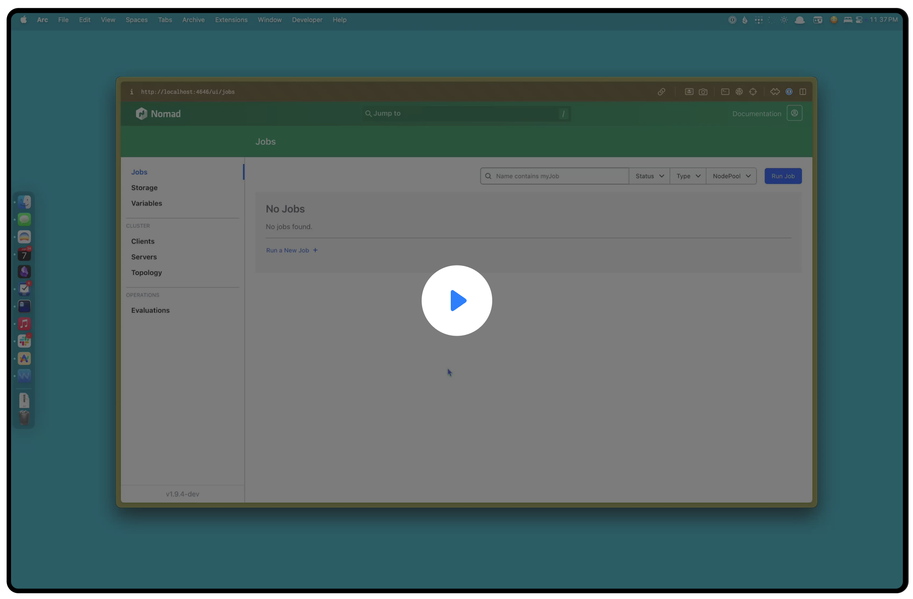

# Nomad Driver for Tart VMs

<p align="center">
  
</p>

A custom task driver for HashiCorp Nomad that enables orchestration and management of [Tart](https://github.com/cirruslabs/tart) virtual machines on macOS.

## Overview

This driver allows Nomad to manage the lifecycle of Tart VMs, providing a way to run macOS virtual machines as Nomad tasks. It integrates with Nomad's ecosystem, enabling users to deploy and manage Tart VMs through Nomad's job specification.

## Video

[](https://share.cleanshot.com/S5VmP3fk)

## Features

- Basic task lifecycle management (start, stop, destroy)
- Task status reporting
- VM stop handling (arbitrary guest signal forwarding is not implemented)
- Placeholder for resource usage statistics
- Startup command execution with output streamed to task logs
- Request VM CPU and memory via Nomad's `resources` block; verify actual sizing (see limitations)
- Optional VM disk size configuration
- Networking modes: host, bridged, or Softnet with allow/expose

## Requirements

- Go 1.27.2 to build (pinned in `go.mod` and `mise.toml`)
- Nomad and Tart on Apple Silicon macOS; an exact supported version matrix is not yet qualified

## Building

To build the driver plugin:

```bash
mise run build
# Cross compile for Apple Silicon
GOOS=darwin GOARCH=arm64 mise run build
```

This creates `dist/nomad-driver-tart`. For checks use `mise run vet` and
`mise run test`; `make test` currently does not run tests.

## Installation

See the [operator runbook](docs/operator-runbook.md) for release assets, Tart's
tap, verification, installation and operational limitations.

## Configuration

For a complete list of all driver and task configuration options, see docs/configuration.md.

### Nomad Agent Configuration

Create or modify your Nomad agent configuration to include the Tart driver plugin:

```hcl
plugin "nomad-driver-tart" {
  config {
    enabled = true
  }
}

client {
  enabled = true

  options {
    "driver.allowlist" = "tart"
  }
}
```

### Job Specification

Here's an example job specification that uses the Tart driver:

```hcl
job "macos-sequoia-vanilla" {
  datacenters = ["dc1"]
  type        = "service"

  update {
    max_parallel = 1
    // Downloading a VM image can take a while as they are
    // tens of GBs in size. Give our jobs enough grace to
    // get setup properly.
    healthy_deadline  = "30m"
    progress_deadline = "60m"
  }

  group "vms" {
    count = 1

    task "vm" {
      driver = "tart"

      # Provision the protected Nomad variable through your approved secure workflow.
      # Do not place a real password on a command line or in job source.
      template {
        data        = <<EOH
SSH_PASSWORD={{ with nomadVar "nomad/jobs/macos-sequoia-vanilla" }}{{ .ssh_password | toJSON }}{{ end }}
EOH
        destination = "secrets/file.env"
        perms = "0600"
        error_on_missing_key = true
        env         = true
      }

      config {
        url          = "ghcr.io/cirruslabs/macos-sequoia-vanilla:latest"
        ssh_user     = "admin"
        ssh_password = "${SSH_PASSWORD}"
        # Whether or not to show the built-in Tart UI for the VM
        # Defaults to false
        show_ui      = true
        # Optional resource configuration for the VM
        # disk_size is the desired disk size in gigabytes
        disk_size  = 60

        # Networking (mutually exclusive modes)
        # Default is shared/NAT (no option needed)
        # network {
        #   mode = "host"         # or "bridged" | "softnet" | "shared"
        #   bridged_interface = "en0"   # required when mode = "bridged"
        #   softnet_allow  = ["192.168.0.0/24"]
        #   softnet_expose = ["2222:22", "8080:80"]
        # }
      }

      resources {
        cores  = 2     # Request; actual guest sizing needs verification
        memory = 4096  # Memory in MB requested for the VM
      }

      logs {
        max_files     = 3
        max_file_size = 10
      }
    }
  }
}
```

## Usage

1. Start the Nomad agent with the plugin:

```bash
nomad agent -dev -config=./examples/agent.hcl -plugin-dir=$(pwd)/dist
```

2. In another terminal, run a job that uses the Tart driver:

```bash
nomad run ./examples/example.nomad.hcl
```

Additional examples:
- `examples/prewarm.nomad.hcl` — pre-pull a Tart image onto clients
- `examples/cursor-self-hosted-worker.nomad.hcl` — install and start a Cursor personal self-hosted worker inside a macOS VM

3. Check the status of the job and get the allocation ID:

```bash
nomad status
```

4. View the logs from the task:

```bash
nomad logs <ALLOCATION_ID>
```

## Development

This driver is currently in development and provides basic functionality. Future enhancements may include:

- Proper Tart VM lifecycle management
- Resource isolation and management
- Network configuration
  - Bridged, host-only, and Softnet options
- Volume mounts
- Health checking

### Continuous Integration

A GitHub Actions workflow automatically formats, vets, and builds the driver for darwin/arm64 on every pull request and push to `main`. Releases are handled by a separate workflow that runs [GoReleaser](https://goreleaser.com/) whenever a tag starting with `v` is pushed. The release workflow can also be manually triggered to produce a snapshot from any commit.


## License

See [LICENSE](LICENSE) file.

Tart's [LICENSE](https://github.com/cirruslabs/tart/blob/main/LICENSE) still applies to your usage of the underlying program.
